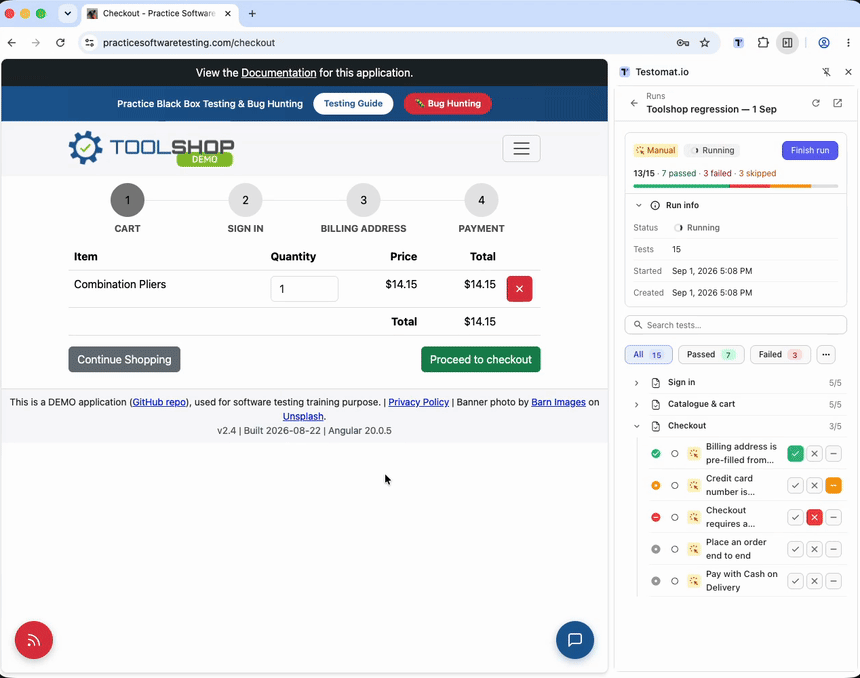

# Testomat.io Chrome extension

Run tests, capture screenshots, record videos, and collect browser logs right
next to the website you're testing. Keep all your testing work in Chrome
without switching tabs.

## What You Can Do

- Run manual tests – Follow test steps and mark results.
- Capture screenshots – Take, annotate, crop, and blur screenshots.
- Record your screen – Capture browser activity and attach video recordings.
- Capture browser logs – Collect console errors, warnings, and network requests.
- Create test cases – Write new tests in Markdown and add parameters.
- Record test steps – Turn your actions on a website into test steps automatically.

## Install

1. Open [Testomat.io in the Chrome Web Store](https://chromewebstore.google.com/detail/testomatio/amcnjlghmkkjfaajanfeghpgbjakdcka)
   and click **Add to Chrome**, then **Add extension**.
2. Click the puzzle icon in Chrome's toolbar and pin **Testomat.io**.
3. Click the pinned icon — the panel opens and asks you to connect.

Chrome 123 or newer. Chrome updates the extension by itself. Details and
pictures, and how to run it from source: [Install and
update](https://docs.testomat.io/advanced/browser-extension/install/).

## Quick start

1. **Connect.** Press **Open Testomat.io & authorize**, paste the token it
   gives you, press **Connect**, pick your project.
   → [Connect](https://docs.testomat.io/advanced/browser-extension/connect/)
2. **Open a run.** **Runs** tab → click a run → click a test.
3. **Mark it.** Tick the steps, press **Passed**, **Failed** or **Skipped**
   (with a comment), then the **›** arrow in the test's pager (or `N` for
   the next untested test). Nothing navigates on its own.
   → [Run a manual run](https://docs.testomat.io/advanced/browser-extension/run-tests/)
4. **Attach evidence.** In the test's **Attachments** fold: **Attach
   screenshot** opens an annotator over the page, **Attach screen
   recording** records the tab; with **Rec** on, marking a test Failed
   attaches its console & network log by itself.

## Guide

| Page | Covers |
|---|---|
| [Install and update](https://docs.testomat.io/advanced/browser-extension/install/) | Add from the Chrome Web Store, pin the icon, updates, install from source |
| [Connect](https://docs.testomat.io/advanced/browser-extension/connect/) | Authorize, pick a project, self-hosted instances, basic mode |
| [Run a manual run](https://docs.testomat.io/advanced/browser-extension/run-tests/) | Runs, steps, statuses, comments, hotkeys, finish, working offline |
| [Attach a screenshot](https://docs.testomat.io/advanced/browser-extension/screenshots/) | Capture the tab, annotate over the page, full-page shots |
| [Attach a screen recording](https://docs.testomat.io/advanced/browser-extension/screen-recording/) | Record the tab, review and trim, attach |
| [Console & network log](https://docs.testomat.io/advanced/browser-extension/console-network-log/) | Rec: the log that lands on a failed result |
| [Create tests](https://docs.testomat.io/advanced/browser-extension/create-tests/) | Add by title, write in the editor, parameters |
| [Step recorder](https://docs.testomat.io/advanced/browser-extension/step-recorder/) | Do the flow once, the test writes itself; polish with AI |
| [Settings and shortcuts](https://docs.testomat.io/advanced/browser-extension/settings/) | Every setting with its default, sign out, keyboard shortcuts |

## Privacy

The extension uploads only to your own Testomat.io instance. What is stored,
what is sent and when — including where Polish with AI goes after that — every
permission and why it is needed, and every off switch: [PRIVACY.md](PRIVACY.md).

## Where to report

Bugs and feature requests go to this repository's
[Issues](https://github.com/testomatio/browser-extension/issues). A useful
report says what you clicked, what happened (with the exact wording of any
message), your Chrome version, and whether the *Basic mode* pill was
showing. Please leave out API tokens and run URLs you would rather keep
private.

## For developers

- [`docs/architecture.md`](docs/architecture.md) — module map, data flows,
  the permission model, storage keys, known traps.
- [`docs/host-handoff.md`](docs/host-handoff.md) — signing the panel in from
  an app that launched the browser (`handoff.json`).

There is no build step: `extension/` runs exactly as it is checked in. The
end-to-end suite lives outside this tree and drives a live Testomat.io
account, so pull requests are verified by maintainers by hand; a few test
seams in the shipped code look unused from here — see architecture §5.3
and leave them alone.

## Licence

MIT — see [LICENSE](LICENSE). Vendored under `extension/vendor/` with their
own licence files: [showdown](https://github.com/showdownjs/showdown) (MIT) and
[OverType](https://github.com/panphora/overtype) (MIT); icon paths from
[Material Symbols](https://fonts.google.com/icons) (Apache-2.0); JetBrains
Mono and Fira Mono under the SIL Open Font License (`extension/shared/fonts/OFL.txt`
and `OFL-FiraMono.txt`).
